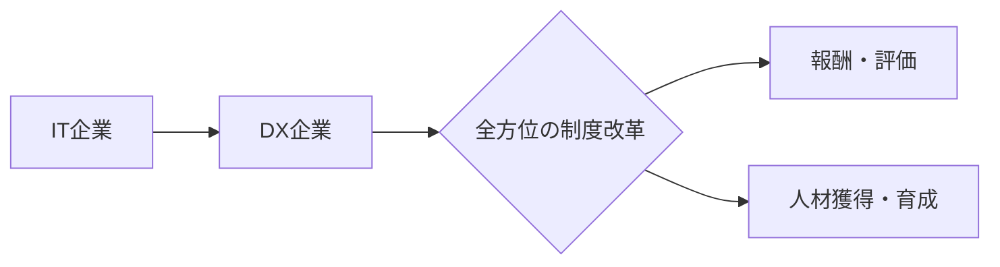
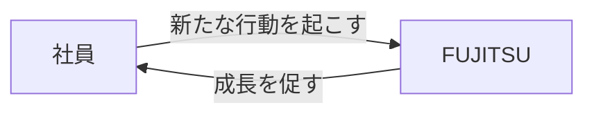
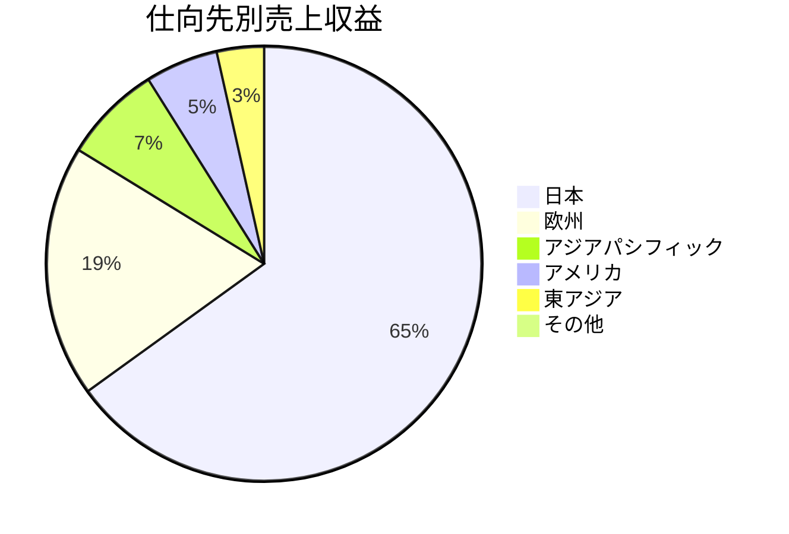
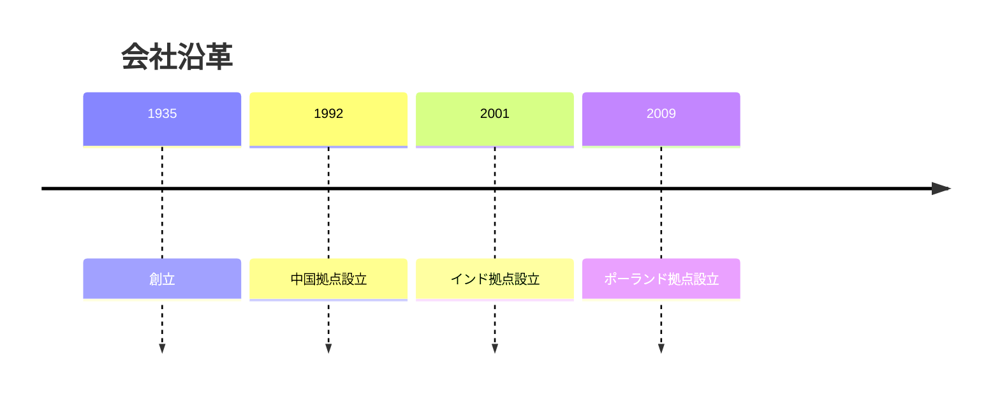
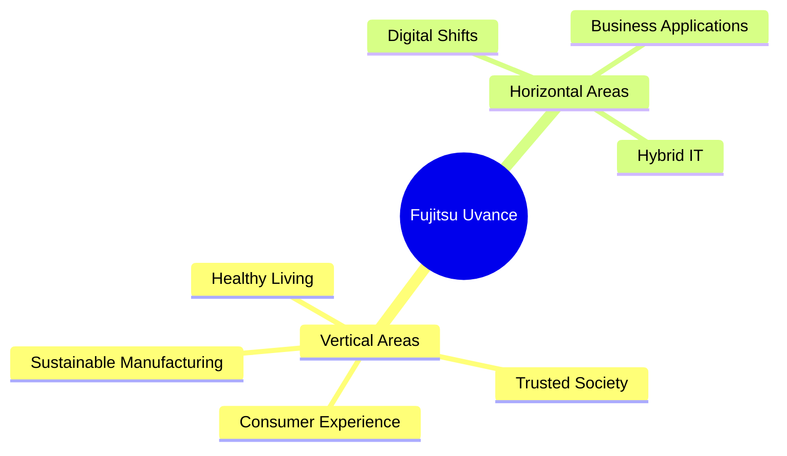
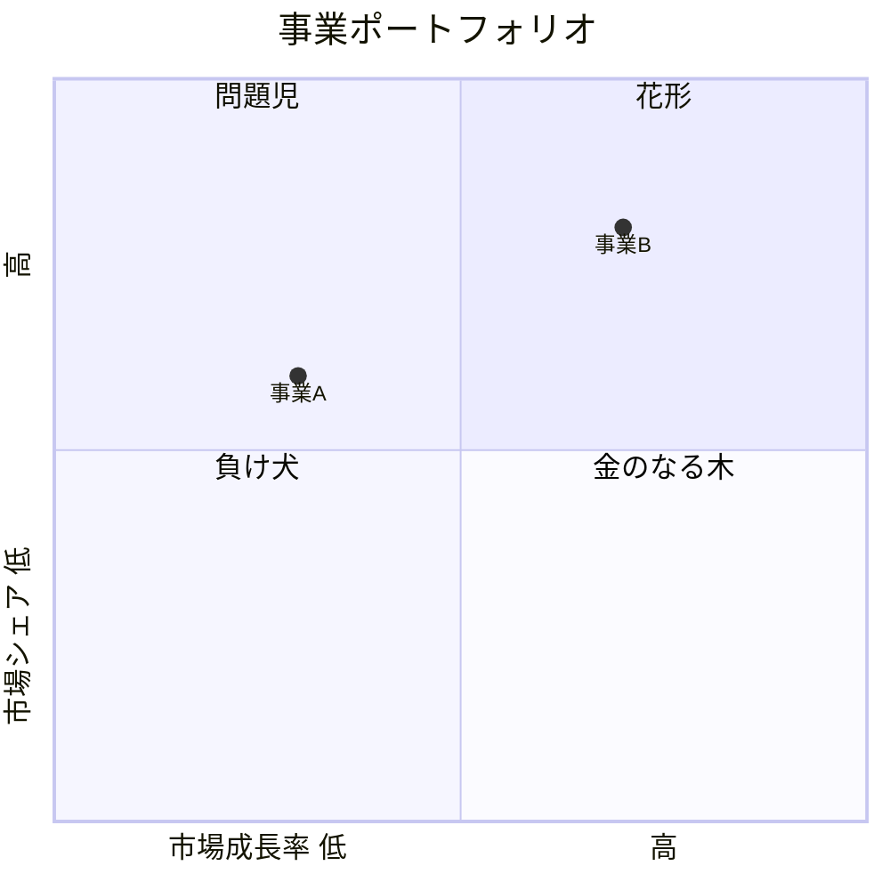

# Mermaidパターン集（頻出5記法）

Step 3 の構造図変換で使う。まずこの5つで表現できるか試す。
無理なら他のMermaid記法→SVG→ラスタ化へフォールバック。

各記法は ```` ```mermaid ```` コードブロックでMarkdownに埋め込む。
GitHub・VS Code・多くのMarkdownビューアでそのまま描画される。

## 目次
- [flowchart（フロー・関係・循環）](#flowchart)
- [pie（円・割合）](#pie)
- [timeline（年表・沿革）](#timeline)
- [mindmap（階層・分類）](#mindmap)
- [quadrantChart（2軸マトリクス）](#quadrantchart)
- [フォールバックの考え方](#フォールバック)

---

## flowchart

最頻出。順序・分岐・循環・組織の流れなど「ノードとエッジ」全般。
向きは `LR`（左→右）/ `TD`（上→下）から図に合わせて選ぶ。



循環（今回の「自律と信頼」のような双方向）：



- ノードラベルは元の文言をそのまま使う
- 分岐の判断ノードは `{ }`、通常ノードは `[ ]`
- エッジのラベルは `-->|ラベル|` で付ける

---

## pie

円・割合。シンプルな構成比向け。中央テキストや細かい色指定が要るなら
SVG `donut_chart` を使う（pieは非対応）。



数値はそのまま渡せば割合は自動計算される。

---

## timeline

年表・沿革・ロードマップ。時系列が主題のとき。



`時点 : 出来事` の形。1時点に複数イベントは ` : ` を続ける。

---

## mindmap

階層・分類・マインドマップ。中心から枝分かれする構造。



インデントで階層を表す。中心ノードは `(( ))` で囲む。

---

## quadrantChart

2軸4象限。PPM、優先度マトリクス、ポジショニングマップなど。



各項目は `名前: [x, y]`（0〜1の座標）。位置はVisionで読み取る。

---

## フォールバック

頻出5記法で表現できないとき、順に下げる：

1. **他のMermaid記法を検討**（頻出ではないが該当すれば使う）
   - `sequenceDiagram`：時系列のやりとり（誰が誰に何を送るか）
   - `stateDiagram-v2`：状態遷移が主題
   - `gantt`：日程・期間・スケジュール
   - `erDiagram`：テーブル間のリレーション
   - これらは「全部覚える」必要はない。図の主題に合うものがあれば採用する程度でよい

2. **SVG**：Mermaidの自動レイアウトでは崩れる独自配置（座標を厳密に置きたい循環図など）
   → `scripts/svg_figures.py` の `flow_cycle` 等

3. **ラスタ化**：独自デザインで図の再現自体が困難、地図など
   → `pdftoppm -png -r 150 -f N -l N`

判断の軸は一貫して **「図にして認識・理解しやすくなるか」**。
Mermaidで素直に描けるならMermaid、量の正確さが要るならSVG、
再現困難ならラスタ、と段階的に選ぶ。
