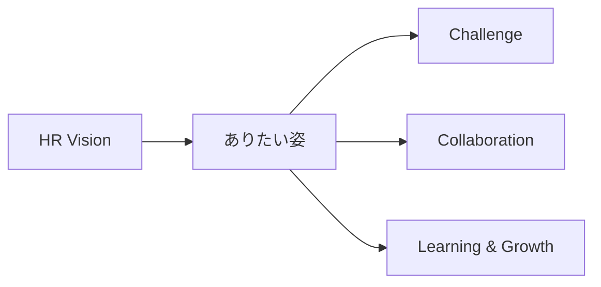

# SVG生成ロジック詳説

`scripts/svg_figures.py` の各図がなぜそう描くのかをまとめる。
SKILL.md から必要に応じて参照する。

## 目次
- [ドーナツグラフ：角度の累積とラベル衝突回避](#ドーナツ)
- [バブル図：面積を量に比例させる √変換](#バブル)
- [フロー図：単純はSVG・複雑はMermaid](#フロー)
- [ラスタ画像の抽出と埋め込み](#ラスタ)

---

## ドーナツ

### 角度の累積
各セグメントの角度は `sweep = 値 / 合計 × 360°`。開始角 `ang` を12時方向
（-90°）から始め、描くたびに `ang += sweep` で足し込む。外円のarcと内円のarcを
逆向きに繋いでドーナツ帯のパスを構成する。

**なぜVisionに描かせないか**：角度の累積は誤差が蓄積する典型例。Visionに
「それっぽいSVG」を書かせると合計が360°にならず、セグメント境界がズレる。
数値だけ認識し、角度計算はコードに任せれば常に正確になる。

### ラベル衝突回避
弧の中点角だけでラベルを置くと、小さいセグメントが密集したときラベルが重なる。
対策は2段階：

1. **衝突回避（予防）**：ラベルを左右グループに分け、y座標順にソート。先頭を
   理想位置に固定し、以降は `y = max(理想y, 直前のy + 行高)` で押し下げる。
   弧上のアンカー点からは折れ線リーダー（polyline）で結び、対応関係を保つ。
2. **検証（事後）**：配置後に全間隔を再走査し、行高未満があれば warning を返す。
   `warnings` が空かどうかで成否を判定できる。

行高は `font_size + 5` を既定とする。ラベルが長い・多い場合は viewBox の
横幅やリーダー長を広げて調整する。

---

## バブル

円の見かけの大きさは半径ではなく**面積**で知覚される。半径を量に比例させると
面積は量の二乗で効き、誇張される。よって面積を量比に一致させるには
**半径 = R_MAX × √(量 / 最大量)** とする。

例：日本67,000とアメリカ4,000は約16.75倍。半径比は √16.75 ≈ 4.1倍になり、
面積が正しく16.75倍に見える。

配置座標 (x, y) はデータからは決まらない（地理的位置・レイアウト依存）ため、
Visionで読み取って渡す。ここは認識が残る部分。

---

## フロー

### 単純な図（2〜3ノード）
ノードを固定座標で配置し、二次ベジェ曲線（`Q`）で弧を描く。矢印は `<marker>` で
定義して `marker-end` で付ける。`flow_cycle()` がこのパターン。

### 複雑な図（多階層・分岐）
座標を手で決めるのが破綻する。SVG手書きより **Mermaid記法** で出力する方が
正確で保守しやすい。Markdownにそのまま埋められGitHubでも描画される。



「ノードとエッジは認識で取り出す／レイアウトはMermaidの自動配置に任せる」と
役割分担する。

---

## ラスタ

### 抽出
ラスタ画像（写真・地図など）は位置指定で抜き出せる。
```bash
pdfimages -png -f 4 -l 4 input.pdf /tmp/img   # 4ページ目の画像をPNG出力
```
複数出るので、ファイルサイズで本命（大きいrgb画像）を見分ける。透過マスク
（smask）が分離されて背景が黒くなることがあるので、Pillowで白背景化や
グレー化を行うとよい。

### ベクターは出ない
matplotlib/PowerPoint等のベクター図は `pdfimages` に出てこない（画像オブジェクト
ではなく描画命令のため）。その場合はページ全体をラスタ化する。
```bash
pdftoppm -png -r 150 -f 4 -l 4 input.pdf /tmp/page
```

### 埋め込み
1ファイル完結を保つなら base64 で `<image href="data:image/png;base64,...">`。
ただし数百KBになるとMarkdownが肥大化するので、重い場合は軽量版への差し替え
（例：地図を省いて配置だけ残す）か、別ファイル参照を検討する。
