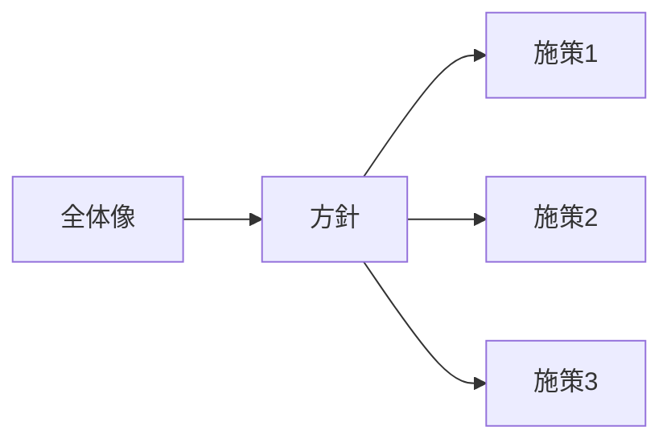

# SVG生成ロジック詳説

`scripts/svg_figures.py` の各図がなぜそう描くのかをまとめる。
SKILL.md から必要に応じて参照する。

## 目次
- [呼び方（スクリプトを書き換えずに使う）](#呼び方)
- [ドーナツグラフ：角度の累積とラベル衝突回避](#ドーナツ)
- [バブル図：面積を量に比例させる √変換](#バブル)
- [フロー図：単純はSVG・複雑はMermaid](#フロー)
- [ラスタ画像の抽出と埋め込み](#ラスタ)

---

## 呼び方

`svg_figures.py` は import して使う。呼び出し用の小さなスクリプトを作業フォルダに書いて、
`<RUN>`（SKILL.md の定義）で動かす。**`svg_figures.py` 自体は書き換えない。**

```python
import sys
sys.path.insert(0, "<SKILL_DIR>/scripts")
from svg_figures import donut_chart, bubble_chart

svg, warnings = donut_chart(
    [("項目A", 62.5, "#1A237E"), ("項目B", 37.5, "#1E88E5")],
    center_top="合計", center_main="1,000", unit="%")   # % を付けたいときだけ unit を渡す
print(warnings)                                          # 空でなければ直す
with open("fig.svg", "w", encoding="utf-8") as f:       # SVG は UTF-8 で書く
    f.write(svg)
```

- ラベルは自動でエスケープされる（`&` `<` を含んでよい）。
- `viewBox` は中身から計算される。枠を決めたいときだけ `width` / `height` を渡す
  （はみ出すと `warnings` に出る）。
- `bubble_chart` は、バブルが重なると `warnings` に出る。座標 (x, y) を離して作り直す。
- 目視確認は `svg_figures.py --render fig.svg --png fig.png`（`cairosvg` があるときだけ）。

---

## ドーナツ

### 角度の累積
各セグメントの角度は `sweep = 値 / 合計 × 360°`。開始角 `ang` を12時方向
（-90°）から始め、描くたびに `ang += sweep` で足し込む。外円のarcと内円のarcを
逆向きに繋いでドーナツ帯のパスを構成する。

**なぜVisionに描かせないか**：角度の累積は誤差が蓄積する典型例。Visionに
「それっぽいSVG」を書かせると合計が360°にならず、セグメント境界がズレる。
数値だけ認識し、角度計算はコードに任せれば常に正確になる。

### ラベル衝突回避
弧の中点角だけでラベルを置くと、小さいセグメントが密集したときラベルが重なる。
対策は2段階（`%` は自動では付かない。割合のときは `unit="%"` を渡す）：

1. **衝突回避（予防）**：ラベルを左右グループに分け、y座標順にソート。先頭を
   理想位置に固定し、以降は `y = max(理想y, 直前のy + 行高)` で押し下げる。
   弧上のアンカー点からは折れ線リーダー（polyline）で結び、対応関係を保つ。
2. **検証（事後）**：配置後に全間隔を再走査し、行高未満があれば warning を返す。
   `warnings` が空かどうかで成否を判定できる。

行高は `font_size + 5` を既定とする。ラベルが長い・多い場合は viewBox の
横幅やリーダー長を広げて調整する。

---

## バブル

円の見かけの大きさは半径ではなく**面積**で知覚される。半径を量に比例させると
面積は量の二乗で効き、誇張される。よって面積を量比に一致させるには
**半径 = r_max × √(量 / 最大量)** とする。

例：67,000 と 4,000 は約16.75倍。半径比は √16.75 ≈ 4.1倍になり、
面積が正しく16.75倍に見える。

配置座標 (x, y) はデータからは決まらない（地理的位置・レイアウト依存）ため、
Visionで読み取って渡す。ここは認識が残る部分。

---

## フロー

### 単純な図（2〜3ノード）
ノードを固定座標で配置し、二次ベジェ曲線（`Q`）で弧を描く。矢印は `<marker>` で
定義して `marker-end` で付ける。`flow_cycle()` がこのパターン。

### 複雑な図（多階層・分岐）
座標を手で決めるのが破綻する。SVG手書きより **Mermaid記法** で出力する方が
正確で保守しやすい。Markdownにそのまま埋められGitHubでも描画される。



「ノードとエッジは認識で取り出す／レイアウトはMermaidの自動配置に任せる」と
役割分担する。

---

## ラスタ

### 抽出
ラスタ画像（写真・地図など）は位置指定で抜き出せる。
```bash
<RUN> <SKILL_DIR>/scripts/pdf_render.py input.pdf --pages 4 --extract-images --outdir <作業フォルダ>   # 4ページ目の画像をPNG出力
```
複数出るので、ファイルサイズで本命（大きいrgb画像）を見分ける。透過マスク
（smask）が分離されて背景が黒くなることがあるので、Pillowで白背景化や
グレー化を行うとよい。

### ベクターは出ない
matplotlib/PowerPoint等のベクター図は `pdfimages` に出てこない（画像オブジェクト
ではなく描画命令のため）。その場合はページ全体をラスタ化する。
```bash
<RUN> <SKILL_DIR>/scripts/pdf_render.py input.pdf --pages 4 --dpi 150 --outdir <作業フォルダ>
```

### 埋め込み
1ファイル完結を保つなら base64 で `<image href="data:image/png;base64,...">`。
ただし数百KBになるとMarkdownが肥大化するので、重い場合は軽量版への差し替え
（例：地図を省いて配置だけ残す）か、別ファイル参照を検討する。
